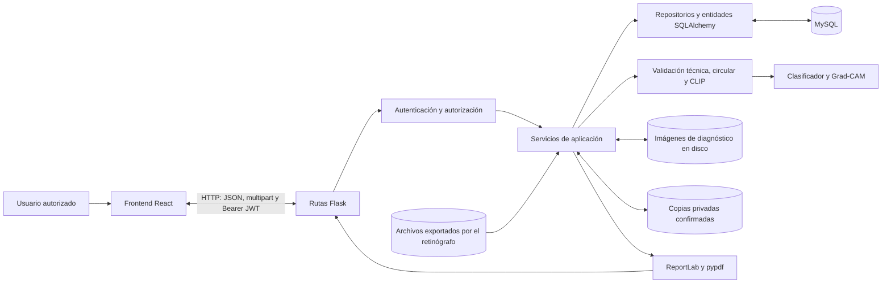
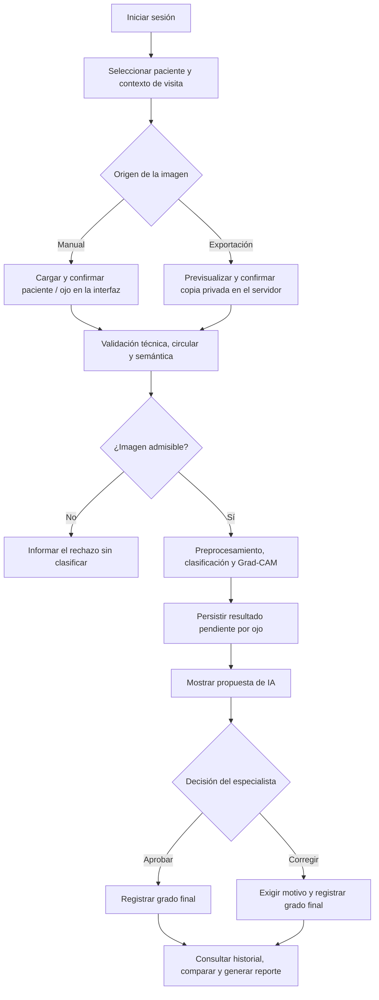

# Sistema web de apoyo a la evaluación de retinopatía diabética

**Inteligencia artificial, análisis de retinografías y revisión del especialista en un mismo flujo de trabajo.**

Proyecto de tesis de Ingeniería de Sistemas orientado a apoyar la detección temprana y la clasificación de la severidad de la retinopatía diabética mediante imágenes de fondo de ojo.


> [!IMPORTANT]
> La clasificación de la IA es información de apoyo clínico. No sustituye la evaluación, el diagnóstico ni la decisión del médico especialista.

## Contenido

- [Descripción general](#descripción-general)
- [Objetivos del proyecto](#objetivos-del-proyecto)
- [Características principales](#características-principales)
- [Tecnologías utilizadas](#tecnologías-utilizadas)
- [Arquitectura del sistema](#arquitectura-del-sistema)
- [Estructura del proyecto](#estructura-del-proyecto)
- [Requisitos previos](#requisitos-previos)
- [Instalación y configuración](#instalación-y-configuración)
- [Ejecución del proyecto](#ejecución-del-proyecto)
- [Flujo de funcionamiento](#flujo-de-funcionamiento)
- [Capturas de pantalla](#capturas-de-pantalla)
- [Estado del proyecto](#estado-del-proyecto)
- [Consideraciones médicas y privacidad](#consideraciones-médicas-y-privacidad)
- [Autor](#autor)

## Descripción general

La retinopatía diabética es una complicación de la diabetes que afecta los vasos sanguíneos de la retina y puede comprometer la visión. La evaluación oportuna de imágenes de fondo de ojo contribuye a identificar alteraciones que requieren atención especializada.

Este sistema integra el registro de pacientes, la organización de visitas clínicas, el procesamiento de retinografías y la consulta de resultados. El backend ejecuta un clasificador de cinco niveles y genera mapas Grad-CAM; el frontend permite revisar sus resultados y registrar una clasificación final a cargo del especialista.

El alcance implementado es la **clasificación de severidad por imagen y por ojo**, no la detección o segmentación individual de lesiones ni la prescripción automática de tratamientos.

### Escala de clasificación

| Código | Clase |
| :---: | --- |
| 0 | Sin retinopatía diabética |
| 1 | Retinopatía diabética leve |
| 2 | Retinopatía diabética moderada |
| 3 | Retinopatía diabética severa |
| 4 | Retinopatía diabética proliferativa |

Las probabilidades mostradas corresponden a la salida del modelo para una imagen. **No son métricas de exactitud, sensibilidad, especificidad ni validación clínica del sistema.**

## Objetivos del proyecto

### Objetivo general

Desarrollar un sistema web de apoyo a la evaluación de retinopatía diabética que integre análisis de imágenes mediante inteligencia artificial, gestión de información clínica y revisión profesional.

### Objetivos específicos

- Registrar pacientes y organizar sus evaluaciones e informes por visita clínica.
- Validar las imágenes recibidas antes de ejecutar la clasificación de severidad.
- Presentar resultados por ojo, probabilidades por clase y visualizaciones Grad-CAM.
- Permitir que el especialista apruebe o corrija la clasificación propuesta, dejando constancia de su decisión.
- Facilitar la consulta del historial, la comparación entre visitas y la generación de reportes de evaluación en PDF.
- Separar las capacidades administrativas, asistenciales y clínicas mediante roles y permisos.

## Características principales

### Módulos implementados

| Módulo | Funcionalidades presentes en el código |
| --- | --- |
| **Autenticación** | Inicio de sesión, JWT, persistencia local de sesión y manejo de respuestas de acceso denegado o sesión expirada. |
| **Pacientes** | Registro con validación de datos y consentimiento informado obligatorio; búsqueda, filtros, paginación en la interfaz y ficha con información diferenciada por alcance de acceso. |
| **Visitas e historial** | Asociación de evaluaciones e informes a visitas; consulta del detalle y comparación de resultados entre visitas del mismo paciente. |
| **Evaluación con IA** | Carga manual de imágenes para OD/OI, previsualización, confirmación de asociación paciente-ojo y clasificación independiente por ojo. |
| **Importación del retinógrafo** | Búsqueda de archivos exportados en un directorio del servidor, propuesta de imágenes por paciente/ojo y confirmación profesional antes del análisis. |
| **Resultados y revisión médica** | Clase propuesta, probabilidades, imagen asociada y Grad-CAM; aprobación o corrección con comentario y motivo obligatorio cuando cambia el grado. |
| **Reportes de evaluación** | Descarga de PDF con plantilla, resultados por ojo, imágenes y estado de validación del especialista, incluso cuando este sigue pendiente. |
| **Informes clínicos** | Creación y consulta de formularios de campo visual, gonioscopia y paquimetría, asociados a una visita existente o nueva. |
| **Dashboard** | Conteos de pacientes, evaluaciones, diagnósticos validados y pendientes; distribución de grados finales de ojos validados y pacientes con visitas recientes. |
| **Configuración** | Alta y edición de usuarios, cambio de estado, asignación de roles y asignación de permisos a roles existentes. |

El historial de versiones de informes y la corrección de fotografías mediante descarte de resultados pendientes tienen condiciones de habilitación. Consulta [Estado del proyecto](#estado-del-proyecto) antes de considerarlos disponibles en una instalación.

### Roles y alcance de acceso

La autorización estricta combina **código de rol habilitante y permisos activos**. Un nombre de rol, por sí solo, no concede todas las capacidades de la siguiente tabla.

| Rol identificado | Alcance previsto por las reglas del backend |
| --- | --- |
| `OFTALMOLOGO` | Evaluación con IA, validación médica, historial clínico, informes y resumen clínico, según los permisos asignados. |
| `ENFERMERO` | Operaciones asistenciales sobre pacientes y lectura de imágenes cuando cuenta con sus permisos; no valida resultados de IA. |
| `ASISTENTE_ADMINISTRATIVO` | Registro y consulta de pacientes con proyección administrativa; sin acceso al historial clínico completo. |
| `ADMINISTRADOR_SISTEMA` | Gestión de configuración, usuarios, roles asignados y permisos. Las reglas estrictas no le otorgan acceso clínico automático. |

El frontend adapta menús y pantallas, pero la decisión de autorización se realiza en el servidor. Los nombres de roles del catálogo también deben ser compatibles con los filtros de interfaz existentes.

## Tecnologías utilizadas

| Área | Tecnologías y uso verificado |
| --- | --- |
| **Frontend** | React 18, TypeScript 5, Vite 5 con React SWC y React Router 6. |
| **Interfaz** | Tailwind CSS 3, componentes shadcn/ui sobre Radix UI, Lucide React y Recharts. |
| **Estado y comunicación** | Zustand para la sesión y estados específicos; Axios para HTTP; proveedor de TanStack Query. |
| **Imágenes en el navegador** | `utif2` para previsualización de TIFF y API Web Crypto para SHA-256 en confirmaciones de exportaciones. |
| **Backend** | Python, Flask 3.1.3, Flask-CORS y python-dotenv. |
| **Persistencia** | MySQL, Flask-SQLAlchemy, SQLAlchemy 2.0.30 y controlador PyMySQL. |
| **Seguridad** | PyJWT y utilidades de hash de contraseñas de Werkzeug. |
| **Clasificación** | PyTorch 2.3.0, torchvision 0.18.0, PyTorch Lightning 2.2.4 y TorchMetrics. |
| **Validación semántica** | Transformers y CLIP `openai/clip-vit-base-patch32`. |
| **Procesamiento y explicación visual** | OpenCV, NumPy, Pillow y `grad-cam`. |
| **PDF** | ReportLab y pypdf. |
| **Verificación** | `unittest` en backend; Vitest, Testing Library, TypeScript y ESLint en frontend; arneses específicos para ensayos MySQL aislados. |

Las versiones exactas del backend están declaradas en [requirements.txt](backend/requirements.txt). Los rangos del frontend y su resolución reproducible están en [package.json](frontend/package.json) y [package-lock.json](frontend/package-lock.json), respectivamente.

## Arquitectura del sistema

La aplicación utiliza una **SPA React** y una **API Flask**. El backend separa las responsabilidades HTTP, la lógica de aplicación y el acceso a datos:

- **Rutas:** recepción de solicitudes, autenticación/autorización y respuestas HTTP.
- **Servicios:** validaciones, coordinación de inferencia, persistencia y generación de documentos.
- **Repositorios y entidades:** consultas y operaciones mediante SQLAlchemy sobre MySQL.
- **Módulo de IA:** validación de imágenes, preprocesamiento, clasificación y Grad-CAM.
- **Almacenamiento:** imágenes asociadas a diagnósticos en disco y copias privadas de exportaciones confirmadas.



### Componente de inteligencia artificial

La inferencia espera el checkpoint `backend/dl_model/resnet50_best.ckpt` y utiliza una ruta de Grad-CAM específica de **ResNet50**. La clase de arquitectura también contempla EfficientNet-B3 y MobileNetV3, pero eso **no constituye un selector de modelos intercambiables**: la inferencia actual depende de la estructura de ResNet50.

El preprocesamiento aplica corrección de luminancia tipo Ben Graham, CLAHE, recorte de la región retiniana, ajuste a `224 × 224` y normalización. El modelo produce cinco probabilidades mediante softmax. CLIP se utiliza para validar el contenido de entrada, no para asignar el grado de retinopatía.

La ejecución del clasificador selecciona CUDA si está disponible y, en caso contrario, CPU. El repositorio contiene código de inferencia y de compatibilidad con checkpoints; no un flujo completo de entrenamiento reproducible.

## Estructura del proyecto

```text
tesis-retinopatia-diabetica/
├── README.md
├── backend/
│   ├── app.py                         # Aplicación Flask y registro de rutas
│   ├── run_local.py                   # Arranque local con comprobaciones
│   ├── database.py                    # SQLAlchemy y sesiones MySQL en UTC
│   ├── requirements.txt
│   ├── assets/pdf/plantilla_clinica.pdf
│   ├── dl_model/                     # Arquitectura, validación e inferencia
│   ├── routes/                       # Blueprints de la API
│   ├── services/                     # Lógica de aplicación y PDF
│   ├── src/
│   │   ├── models/                   # Entidades de dominio y persistencia
│   │   └── repositories/             # Acceso a datos
│   ├── utils/                        # Seguridad, fechas y almacenamiento
│   ├── migrations/                   # SQL incremental y propuestas controladas
│   ├── docs/                         # Contratos y notas de verificación
│   ├── discard_mysql77/              # Arnés de pruebas MySQL aisladas
│   └── test_*.py                     # Pruebas del backend
└── frontend/
    ├── package.json
    ├── package-lock.json
    ├── vite.config.ts
    ├── tailwind.config.ts
    ├── eslint.config.js
    ├── public/                       # Recursos públicos de la interfaz
    └── src/
        ├── App.tsx                   # Rutas y proveedores
        ├── assets/                   # Recursos visuales de la aplicación
        ├── components/               # Layout, componentes médicos y UI
        ├── features/
        │   ├── auth/
        │   ├── configuration/
        │   ├── dashboard/
        │   ├── diagnosis/
        │   ├── patients/
        │   └── reports/
        ├── hooks/
        ├── lib/                      # HTTP, fechas, imágenes y validaciones
        └── test/                     # Pruebas del frontend
```

El árbol resume el código principal. No muestra dependencias instaladas, cachés, compilados, archivos de entorno, imágenes clínicas cargadas, checkpoints ni scripts privados de base de datos.

## Requisitos previos

- **Git** para obtener el repositorio.
- **Python y pip**, en una versión compatible con las dependencias fijadas, especialmente PyTorch y torchvision. No se fija una versión del intérprete en el repositorio.
- **Node.js y npm**, en una versión mantenida compatible con Vite 5. El proyecto no fija una versión de Node.js; el paquete Vite del lockfile declara `^18.0.0 || >=20.0.0`.
- **MySQL 8**, familia a la que están dirigidos los scripts SQL versionados. La versión menor y la instalación concreta deben ser verificadas por el operador.
- **Checkpoint compatible de ResNet50**, proporcionado por el mantenedor.
- **Navegador moderno**, con soporte de Web Crypto para confirmar exportaciones. Utiliza `localhost` en desarrollo y HTTPS fuera de ese contexto.
- Acceso a los pesos de **CLIP y torchvision**, mediante descarga inicial o caché previamente preparada.
- Permisos del proceso backend sobre sus directorios de imágenes y sobre una carpeta privada preexistente. Una GPU es opcional; no se establecen requisitos de memoria o tiempos de ejecución.

> [!WARNING]
> El clon público no es una instalación autónoma: no incluye el esquema SQL completo, las credenciales de acceso ni los pesos entrenados. Estos recursos deben obtenerse por un canal autorizado, sin publicar datos reales.

## Instalación y configuración

### 1. Clonar el repositorio

```bash
git clone https://github.com/JonyPls/tesis-retinopatia-diabetica.git
cd tesis-retinopatia-diabetica
```

### 2. Instalar las dependencias del backend

Desde la raíz del repositorio, en **Windows / PowerShell**:

```powershell
cd backend
python -m venv venv
.\venv\Scripts\python.exe -m pip install -r requirements.txt
```

Alternativa en **Linux / macOS**:

```bash
cd backend
python3 -m venv venv
./venv/bin/python -m pip install -r requirements.txt
```

Se invoca directamente el intérprete del entorno virtual; no es necesario cambiar la política de ejecución de PowerShell para activarlo.

### 3. Configurar el backend

Crea localmente `backend/.env`, excluido de Git, y asigna los valores de tu instalación. No se distribuye un archivo de ejemplo listo para copiar. También puedes proporcionar las variables al proceso.

| Variable | Uso |
| --- | --- |
| `DB_HOST` | Host de MySQL. |
| `DB_NAME` | Nombre del esquema autorizado. |
| `DB_USER` | Usuario de base de datos. Utiliza privilegios mínimos para la aplicación. |
| `DB_PASSWORD` | Contraseña de ese usuario. No debe publicarse. |
| `SECRET_KEY` | Secreto para firma y verificación de JWT. Genera uno propio y mantenlo fuera del repositorio. |
| `FRONTEND_ORIGIN` | Origen permitido por CORS. Para los comandos de este README: `http://localhost:8080`. Admite varios orígenes separados por comas. |
| `RETINOGRAPH_PRIVATE_DIR` | Ruta absoluta a una carpeta privada **ya existente**, necesaria para `run_local.py`; debe quedar fuera de `uploads` y de las carpetas estáticas. Preferiblemente, también fuera del repositorio. |
| `RETINOGRAPH_EXPORT_DIR` | Opcional para carga manual; directorio absoluto de exportaciones cuando se utiliza la importación del retinógrafo. |
| `APP_TIMEZONE` | Opcional: zona de presentación de fechas del PDF; el valor predeterminado es `America/Lima`. |

`DB_HOST` se incorpora directamente a la URI; no existe una variable `DB_PORT` independiente en la implementación actual.

**Otras variables reconocidas:** `FLASK_PORT` y `FLASK_DEBUG` se utilizan al ejecutar `app.py` directamente. No cambian el puerto ni el modo de depuración de `run_local.py`, que fija `127.0.0.1:5000` y desactiva debug.

> El CORS predeterminado de `app.py` permite `http://localhost:5173`, mientras Vite está configurado en `8080`. Configura `FRONTEND_ORIGIN` explícitamente; no es necesario modificar el código.

### 4. Preparar la base de datos

1. Solicita al mantenedor un esquema completo y sanitizado compatible con las entidades y repositorios actuales.
2. Prepara una instancia de desarrollo autorizada y una cuenta de aplicación con sus permisos de conexión.
3. Importa el esquema mediante el procedimiento acordado con el mantenedor, incluyendo sus catálogos: documentos, cargos, roles, permisos, grados de retinopatía y tipos de informe.
4. Comprueba las relaciones de autorización y el mapeo de grados `0–4`. Los formularios actuales esperan los tipos de informe `2` —campo visual—, `3` —gonioscopia— y `4` —paquimetría—.
5. Provisiona una cuenta inicial autorizada con contraseña almacenada como hash compatible con Werkzeug. No hay un comando público de bootstrap ni credenciales predeterminadas documentadas.

El SQL completo de `backend/db/` está excluido de Git. Los archivos de [backend/migrations/](backend/migrations/) **no lo reemplazan**: incluyen propuestas, operaciones no idempotentes y cambios sujetos a autorización. No los ejecutes en bloque ni sobre una base desconocida. El arranque no crea automáticamente el esquema.

### 5. Preparar los modelos y el almacenamiento

- Obtén de una fuente confiable el checkpoint compatible y colócalo en `backend/dl_model/resnet50_best.ckpt`. Los archivos `.ckpt` y `.pth` de ese directorio están excluidos de Git.
- Prepara la descarga o caché de `openai/clip-vit-base-patch32`. El backend intenta precargar CLIP al iniciar; torchvision también puede requerir sus pesos preentrenados al instanciar el clasificador.
- Crea y protege la carpeta indicada por `RETINOGRAPH_PRIVATE_DIR`; la aplicación no crea esa raíz privada.
- Para importar exportaciones, prepara `RETINOGRAPH_EXPORT_DIR` sin enlaces simbólicos o junctions en las rutas utilizadas.
- El diagnóstico guarda las imágenes asociadas y Grad-CAM en `backend/uploads/retinas/` cuando se inicia desde `backend/`. `run_local.py` normaliza ese directorio de trabajo.

La importación utiliza archivos con este patrón, no una API de adquisición del dispositivo:

```text
<documento>_<MMDDYYYY>_<HHMMSS>_<tipo_imagen>_<R|L>_<secuencia>.<extension>
```

`R` corresponde a OD y `L` a OI. Se admiten las extensiones `tif`, `tiff`, `jpg`, `jpeg` y `png`; las exportaciones verificadas deben tener una sola imagen/página. La coincidencia del nombre no acredita por sí sola la identidad del paciente ni la procedencia del equipo.

### 6. Instalar las dependencias del frontend

En otra terminal, desde la raíz del repositorio:

```bash
cd frontend
npm ci
```

La API predeterminada es `http://localhost:5000/api`. Solo si necesitas otra dirección, configúrala mediante `VITE_API_BASE_URL` en el entorno de Vite o en `frontend/.env.development.local`, archivo excluido de Git.

| Variable del frontend | Comportamiento |
| --- | --- |
| `VITE_API_BASE_URL` | URL base de la API, incluyendo `/api`. |
| `VITE_DIAGNOSIS_DISCARD_ENABLED` | Solo el texto exacto `true` habilita la interfaz de corrección por descarte. No habilita permisos, tablas ni controles del backend. |

Las variables `VITE_*` son públicas en el navegador: **nunca deben contener secretos**. Reinicia Vite después de cambiarlas.

## Ejecución del proyecto

### Backend — terminal 1

Con MySQL, variables y almacenamiento previamente preparados, desde `backend/`:

**Windows / PowerShell**

```powershell
$env:FRONTEND_ORIGIN = "http://localhost:8080"
.\venv\Scripts\python.exe run_local.py
```

**Linux / macOS**

```bash
FRONTEND_ORIGIN=http://localhost:8080 ./venv/bin/python run_local.py
```

Este arranque habilita la lectura del historial de informes, mantiene deshabilitadas su edición y anulación e intenta verificar las condiciones del descarte de IA. Si estas últimas no se cumplen, deshabilita el descarte sin modificar MySQL.

### Frontend — terminal 2

Desde `frontend/`:

```bash
npm run dev -- --host localhost --port 8080 --strictPort
```

| Servicio | Dirección local |
| --- | --- |
| Interfaz e inicio de sesión | http://localhost:8080/ |
| Respuesta base de la API | http://127.0.0.1:5000/ |
| Base HTTP utilizada por Axios | http://localhost:5000/api |

Accede con una cuenta provisionada para tu instalación. `localhost` y `127.0.0.1` identifican aquí la misma máquina, pero son orígenes distintos para el navegador: utiliza la URL del frontend configurada en CORS.

Como comprobación básica, `GET /` del backend debe responder un JSON de disponibilidad. `GET /api/dashboard/clinico` sin Bearer debe devolver `401`. Esto no verifica la inferencia ni la integridad del esquema.

### Comandos de verificación disponibles

Desde `frontend/`:

```bash
npm run lint
npm run build
npx --no-install vitest run
```

Desde `backend/`, usando el intérprete del entorno virtual:

```bash
python -m unittest test_run_local.py
```

El último comando comprueba el arranque mediante dobles de prueba, sin levantar el servidor ni ejecutar modelos. Usa el ejecutable del entorno virtual en lugar de `python` si no lo has activado. Los ensayos de integración MySQL tienen sus propios prerrequisitos de aislamiento y **no son pasos de instalación**. La existencia de estas pruebas no implica que todas hayan sido ejecutadas o aprobadas en cada entorno.

## Flujo de funcionamiento

1. **Autenticación.** El usuario inicia sesión y el frontend envía el JWT como Bearer en las solicitudes protegidas.
2. **Contexto clínico.** Selecciona un paciente y una visita existente compatible, o inicia una evaluación que crea una nueva visita si dispone del permiso correspondiente.
3. **Selección por ojo.** Carga una o dos retinografías manualmente, o consulta las exportaciones disponibles en el servidor.
4. **Confirmación humana.** Revisa paciente, lateralidad y previsualización. En la importación, el servidor vincula la confirmación al profesional, paciente, ojo y hash de la imagen, y conserva una copia privada.
5. **Validación de entrada.** El backend comprueba formato, dimensiones, tamaño, región circular dominante y contenido semántico con CLIP. Una imagen rechazada no pasa al clasificador.
6. **Inferencia y persistencia.** Se aplica el preprocesamiento, se ejecuta la clasificación y se genera Grad-CAM. Los resultados se guardan por ojo y se asocian a la visita.
7. **Revisión del especialista.** Se muestran grado y probabilidades propuestos. El especialista aprueba o corrige el grado y registra el motivo si cambia la propuesta. La validación conserva el resultado de IA separado del resultado final.
8. **Consulta y documentación.** El usuario autorizado puede consultar la visita, comparar evaluaciones, descargar el reporte PDF o registrar los informes clínicos implementados.



### Restricciones de entrada y recuperación

- Formatos de diagnóstico: **JPEG, PNG y TIFF**, con coherencia entre contenido, extensión y MIME.
- Límites predeterminados: **20 MiB** por imagen, al menos **350 px** en el lado menor, hasta **8192 px** por lado y **30 millones de píxeles**.
- Si CLIP no está disponible, el resto de la aplicación puede iniciar, pero la validación semántica devuelve `503` y **no se omite para ejecutar la inferencia**.
- Ante respuestas de persistencia incierta, el flujo consulta los resultados registrados de la visita antes de permitir nuevos envíos. Un error de comunicación no demuestra que el resultado no se haya guardado.

## Capturas de pantalla

No se identificaron capturas versionadas de la interfaz preparadas para publicación. Los recursos de retina incluidos en el frontend no se presentan aquí como capturas del sistema.

<!-- Agregar aquí una captura del inicio de sesión, usando una ruta relativa a un archivo que se incorpore al repositorio. -->
<!-- Agregar aquí una captura del dashboard con datos sintéticos. -->
<!-- Agregar aquí una captura del flujo de evaluación por ojo y de sus resultados, sin datos identificables. -->
<!-- Agregar aquí una captura de la revisión del especialista y de la comparación de visitas. -->
<!-- Agregar aquí una captura de los formularios de informes clínicos con datos sintéticos. -->

Utiliza únicamente datos sintéticos o material debidamente anonimizado y autorizado. Revisa también nombres de archivos, metadatos y contenido visible antes de publicar imágenes.

## Estado del proyecto

**Proyecto académico con funcionalidades implementadas y verificaciones automatizadas en el repositorio; no se presenta como un producto certificado ni listo para producción.**

| Área | Estado corroborable en el código |
| --- | --- |
| Flujo principal | Existen frontend y endpoints para autenticación, pacientes, evaluación por ojo, revisión médica, historial, PDF, informes y administración. Su ejecución depende de la configuración y recursos externos descritos. |
| Historial de versiones de informes | Implementado y habilitado por `run_local.py`; requiere el esquema compatible. `app.py` por sí solo no habilita esa bandera. |
| Edición y anulación de informes | Existen rutas y lógica condicionadas, pero `run_local.py` fija `REPORTS_EDIT_ENABLED=False` y `REPORTS_ANNUL_ENABLED=False`. No se consideran capacidades activas del flujo local documentado. |
| Eliminación de informes | La ruta `DELETE` está bloqueada; no se documenta como funcionalidad disponible. |
| Corrección de fotografías por descarte | Implementación opt-in para resultados propios pendientes y elegibles. Requiere permisos, esquema, dependencias y almacenamiento verificados, además de la bandera del frontend. No sustituye la corrección médica de un grado. |
| Unicidad del correo del paciente | Hay comprobación en aplicación; existe una propuesta SQL pendiente para reforzarla. No se presupone que el índice esté instalado en una base concreta. |
| Reproducibilidad del clon | Limitada por la ausencia del esquema completo, bootstrap público y checkpoint entrenado. |
| Evaluación del modelo | No se publican aquí métricas de rendimiento: la definición de métricas en la arquitectura no acredita resultados experimentales. |

### Información que requiere revisión del mantenedor

- Publicación de un esquema sanitizado y un procedimiento seguro para inicializar catálogos y la primera cuenta.
- Distribución autorizada del checkpoint, identificación de su versión y documentación de su evaluación.
- Versiones de Python, Node.js y MySQL efectivamente utilizadas para una instalación reproducible.
- Estado real de migraciones, permisos y capacidades opt-in en cada base desplegada.
- Incorporación de capturas anonimizadas y verificación visual de los diagramas en GitHub.
- Validación integral con MySQL y modelos reales; no basta la comprobación estática del código.

## Consideraciones médicas y privacidad

### Alcance médico

- La salida de IA debe ser interpretada por un profesional competente y en el contexto clínico del paciente.
- Grad-CAM visualiza regiones que influyen en la respuesta del modelo; **no constituye segmentación de lesiones ni una explicación causal validada clínicamente**.
- La confirmación de una fotografía es una declaración del usuario sobre su asociación, no una certificación automática del paciente, la lateralidad o el equipo.
- No se atribuyen al sistema certificación médica, autorización sanitaria ni validación clínica acreditada.

### Controles presentes

- JWT con firma HS256 y expiración de 24 horas; verificación de cuenta activa y consulta actual de roles/permisos en las solicitudes protegidas.
- Contraseñas almacenadas y verificadas mediante funciones de hash de Werkzeug.
- Autorización por operación y proyección de campos de pacientes según alcance.
- CORS limitado a orígenes configurados; credenciales Bearer en cabeceras y rechazo de JWT en parámetros de URL.
- Acceso autenticado a imágenes registradas; respuestas de imágenes y determinados recursos clínicos con `Cache-Control: private, no-store`.
- Validación acotada de archivos y comprobaciones de rutas; copias privadas de exportaciones confirmadas con integridad SHA-256.
- Separación del resultado de IA y la decisión médica, con registro del profesional y motivo de corrección.
- Exclusión de `.env`, SQL privado, checkpoints y cargas de `backend/uploads/retinas/` mediante `.gitignore`.

### Precauciones recomendadas — no garantías implementadas

Antes de utilizar datos reales, define una política de consentimiento, acceso, conservación, eliminación, respaldo y atención de incidentes acorde con la normativa aplicable. El registro de consentimiento en un formulario no demuestra por sí mismo cumplimiento legal.

El frontend persiste el token y datos de sesión en **localStorage**; deben considerarse los riesgos de XSS y de equipos compartidos. Protege también el disco, las copias de seguridad y el acceso del sistema operativo: los hashes no cifran las imágenes.

Configura HTTPS y una infraestructura de despliegue adecuada fuera del desarrollo local. Los comandos de este documento utilizan servidores de desarrollo y no establecen cifrado de transporte, cifrado en reposo, anonimización automática, MFA ni una política integral de auditoría o retención. Estos controles requieren evaluación y configuración adicionales.

No publiques imágenes clínicas, documentos, nombres de pacientes, exportaciones, dumps ni credenciales en GitHub, incidencias o capturas.

## Autor

**[JonyPls](https://github.com/JonyPls)**

Proyecto desarrollado con fines académicos y de investigación como parte de una tesis de Ingeniería de Sistemas.
